# Threat Hunt Report: Scattered Invoice – MFA Fatigue Account Takeover and Business Email Compromise – LogN Pacific Finance Department

**Classification:** Public
**Hunt Status:** Complete
**Hunt Outcome:** Confirmed Threat
**Overall Severity:** High

---

## Table of Contents

- [Executive Summary](#executive-summary)
- [1. Hunt Details](#1-hunt-details)
- [2. Hypothesis or Trigger](#2-hypothesis-or-trigger)
- [3. Methodology](#3-methodology)
- [4. Key Findings](#4-key-findings)
- [5. Detailed Analysis](#5-detailed-analysis)
- [6. Indicators of Compromise](#6-indicators-of-compromise)
- [7. Intelligence Gaps](#7-intelligence-gaps)
- [8. ATT&CK Mapping](#8-attck-mapping)
- [9. Recommendations](#9-recommendations)
- [10. Appendix & References](#10-appendix--references)
- [11. Sensitivity Label](#11-sensitivity-label)

---

## Executive Summary

### Purpose of the Hunt

LogN Pacific Financial Services was contacted by its bank's fraud department after a £24,500 vendor payment was redirected to an unknown account. The receiving bank flagged the transaction and froze the funds. The finance team processed the payment after receiving an email from a known colleague, Mark Smith, containing "updated banking details." The evening before, Mark had reported repeated MFA prompts and eventually approved one to make them stop. The next morning, his team found inbox rules nobody had created.

This hunt was conducted to confirm the account compromise, identify the attacker's infrastructure, scope the damage, and attribute the activity to a known threat actor.

### Hunt Scope

| Item | Details |
|---|---|
| Assets / Environments | Mark Smith's Microsoft 365 account (m.smith@lognpacific.org), Exchange Online mailbox, OneDrive for Business – Finance department |
| Timeframe Analyzed | 2026-02-25 21:00 UTC to 2026-02-26 00:00 UTC |
| Data Sources | Microsoft Sentinel – `SigninLogs`, `CloudAppEvents`, `EmailEvents` |

### Key Findings Summary

The compromise is confirmed. An attacker signed in as Mark Smith from **205.147.16.190** (Netherlands) on an **Ubuntu Linux** device, very different from Mark's normal Windows device in the US. The attacker got past MFA by repeatedly sending push notifications until Mark approved one (MFA fatigue).

Once inside the mailbox, the attacker:

1. **Read Mark's email** to understand ongoing conversations.
2. **Created a hidden forwarding rule** (named `.`) that sends any email containing "invoice, payment, wire, transfer" to the external address **insights@duck.com**.
3. **Created a hidden delete rule** (named `..`) that removes emails containing security-related words such as "suspicious," "phishing," and "compromised," so Mark would not see any warnings.
4. **Hijacked an existing invoice thread** and sent a fraudulent email, "RE: Invoice #INV-2026-0892 - Updated Banking Details," to finance colleague **j.reynolds@lognpacific.org**. This is the email that led to the redirected payment.
5. **Accessed files in OneDrive for Business.**

Mark's own activity from his usual US location was reviewed and found to be legitimate. Conditional Access did not apply to the attacker's sign-in, so nothing blocked a login from an unmanaged foreign device. The tactics match those of **Scattered Spider**, a financially motivated group known for MFA fatigue and business email compromise.

- **Severity:** High
- **Affected Systems:** 1 user account (m.smith@lognpacific.org), its Exchange Online mailbox and OneDrive for Business; 1 targeted recipient (j.reynolds@lognpacific.org)
- **Immediate Actions Needed:** Revoke all active sessions for m.smith, reset the password and MFA registration, remove both malicious inbox rules, block the forwarding address and attacker IP, and notify the finance team and the bank.

---

## 1. Hunt Details

| Field | Value |
|---|---|
| Incident ID | IR-2026-0225-BEC |
| Start Date | 2026-10-15 |
| End Date | 2026-10-15 |
| Lead Analyst(s) | [Your Name] |
| Team Members | N/A – individual investigation |
| Hunt Type | IR follow-up (triggered by external bank fraud report and user report) |

### Data Sources Used

| Source | Used | Platform / Tool | Notes |
|---|---|---|---|
| Entra ID sign-in logs | Yes | Microsoft Sentinel – `SigninLogs` | Authentication results, IP, location, user agent, session ID, Conditional Access status |
| Cloud app activity | Yes | Microsoft Sentinel – `CloudAppEvents` | Mailbox actions, inbox rule creation (`RawEventData`), OneDrive file access |
| Email activity | Yes | Microsoft Sentinel – `EmailEvents` | Sender, sender IP, subject, recipient, email direction |
| EDR telemetry | No | N/A | Not provided in this environment |
| Firewall / proxy logs | No | N/A | Not provided in this environment |
| Threat intelligence feeds | No | N/A | Lab OPSEC prohibited submitting IOCs to public platforms |

---

## 2. Hypothesis or Trigger

**Trigger Type:**

- [ ] A defined hypothesis (e.g., possible DNS tunneling activity)
- [ ] New threat intelligence relevant to the sector
- [x] Anomalous behavior observed in network or host logs
- [x] Follow-up from a previous hunting report or incident response case

**Hypothesis Statement:**

> An attacker may have gained access to Mark Smith's Microsoft 365 account through MFA fatigue (push bombing), which would be observable as repeated MFA challenges followed by a successful sign-in from an unfamiliar IP, location, and device in `SigninLogs`, followed by mailbox manipulation in `CloudAppEvents` and a fraudulent email in `EmailEvents`.

**Background / Context:**

- **Incident:** IR-2026-0225-BEC, reported 26 February 2026 at 09:30 UTC by an external bank fraud department.
- **Financial impact:** £24,500 redirected (funds frozen by the receiving bank).
- **User report:** On the evening of 25 February, Mark Smith received repeated MFA prompts while at home and eventually approved one, assuming it was an IT glitch.
- **Threat intelligence:** The pattern matches a financially motivated group known for MFA fatigue, help desk social engineering, business email compromise against finance teams, use of legitimate cloud infrastructure, and targeting of hospitality, retail, and financial services (including MGM Resorts, Caesars Entertainment, and UK retailers).

**Success Criteria:**

- **Confirmed if:** Sign-ins for Mark's account appear from an IP, location, or device that does not match his baseline, preceded by failed MFA challenges, and followed by malicious mailbox activity.
- **Refuted if:** All sign-ins match Mark's normal location, device, and behavior, and no unauthorized mailbox changes are found.

---

## 3. Methodology

### Frameworks Applied

- [x] MITRE ATT&CK
- [ ] Cyber Kill Chain
- [x] SANS Threat Hunting Methodology
- [ ] Infrastructure enrichment platform (e.g., Hunt.io)
- [ ] Other: [Specify]

### Tools & Platforms

| Tool | Purpose |
|---|---|
| Microsoft Sentinel (workspace `law-cyber-range`) | Log search and correlation |
| Kusto Query Language (KQL) | Querying `SigninLogs`, `CloudAppEvents`, and `EmailEvents` |

### Hunt Steps

1. Confirmed the compromised identity and found the suspicious "updated banking details" email sent from Mark's account.
2. Baselined Mark's sign-in activity and compared the two source IPs, locations, and user agents.
3. Isolated genuine MFA challenge failures (ResultType 50074) from other sign-in interrupts to measure the MFA fatigue attack.
4. Pivoted on the attacker IP in `CloudAppEvents` to build a timeline of post-authentication actions.
5. Parsed `RawEventData` for both `New-InboxRule` events to extract rule names, forwarding destination, keywords, and processing flags.
6. Pivoted to `EmailEvents` to identify the BEC recipient, subject line, and email direction.
7. Checked for additional data access (OneDrive) and identified the session ID tying the attacker activity together.
8. Reviewed Conditional Access status and measured timing between MFA challenges and between rule creations.
9. Re-examined Mark's legitimate activity to rule out compromise of his baseline session.
10. Determined containment priority and attributed the TTPs to a known threat actor.

### Queries Used

**Query 1 – Emails sent by Mark Smith during the incident window**

```kql
EmailEvents
| where TimeGenerated between (datetime(2026-02-25 21:00) .. datetime(2026-02-26, 00:00))
| where SenderDisplayName contains "Mark Smith"
| project SenderDisplayName, SenderFromAddress, SenderIPv4, Subject, RecipientEmailAddress
```

- **Purpose:** Confirm the compromised account and find suspicious outbound email.
- **Results:** 1 email from m.smith@lognpacific.org, sent from 205.147.16.190, subject "RE: Invoice #INV-2026-0892 - Updated Banking Details," to j.reynolds@lognpacific.org.

**Query 2 – Sign-in baseline for Mark Smith**

```kql
SigninLogs
| where TimeGenerated between (datetime(2026-02-25 21:00) .. datetime(2026-02-26, 00:00))
| where UserPrincipalName contains "smith"
| project UserPrincipalName, IPAddress, Location, AppDisplayName, ResultType, AuthenticationRequirement, TimeGenerated, UserAgent, SessionId
```

- **Purpose:** Baseline Mark's sign-ins and identify anomalous IPs, locations, devices, and sessions.
- **Results:** 37 sign-ins from two IPs: 172.175.65.103 (US, Windows/Chrome) and 205.147.16.190 (NL, Ubuntu/Firefox). Two distinct session IDs.

**Query 3 – MFA result breakdown for the attacker IP**

```kql
SigninLogs
| where TimeGenerated between (datetime(2026-02-25 21:00) .. datetime(2026-02-26, 00:00))
| where UserPrincipalName contains "smith"
| project UserPrincipalName, IPAddress, Location, AppDisplayName, ResultType, AuthenticationRequirement, UserAgent
| where IPAddress == "205.147.16.190" and AppDisplayName == "One Outlook Web"
| summarize count() by ResultType
```

- **Purpose:** Count genuine MFA challenge failures versus other results.
- **Results:** ResultType 0 = 24, 50140 = 4, 50074 = 2.

**Query 4 – Attacker post-authentication activity**

```kql
CloudAppEvents
| where TimeGenerated between (datetime(2026-02-25 21:00) .. datetime(2026-02-26, 00:00))
| where IPAddress == "205.147.16.190"
| sort by TimeGenerated asc
| project TimeGenerated, AccountDisplayName, IPAddress, ActionType
```

- **Purpose:** Build a timeline of what the attacker did after signing in.
- **Results:** MailItemsAccessed (first action), New-InboxRule (x2), MailItemsAccessed, Create, Send.

**Query 5 – Inbox rule configuration**

```kql
CloudAppEvents
| where TimeGenerated between (datetime(2026-02-25 21:00) .. datetime(2026-02-26, 00:00))
| where IPAddress == "205.147.16.190" and ActionType == "New-InboxRule"
| sort by TimeGenerated asc
| project TimeGenerated, AccountDisplayName, IPAddress, ActionType, RawEventData
```

- **Purpose:** Extract rule names and parameters from `RawEventData`.
- **Results:** 2 rules. Rule `.` forwards to insights@duck.com on "invoice, payment, wire, transfer" with StopProcessingRules = True. Rule `..` targets "suspicious, security, phishing, unusual, compromised, verify."

**Query 6 – Emails sent from the attacker IP**

```kql
EmailEvents
| where TimeGenerated between (datetime(2026-02-25 21:00) .. datetime(2026-02-26, 00:00))
| where SenderIPv4 == "205.147.16.190"
| project SenderDisplayName, SenderFromAddress, SenderIPv4, Subject, RecipientEmailAddress, EmailDirection
```

- **Purpose:** Identify the BEC recipient, subject, and whether the email stayed inside the organization.
- **Results:** 1 email to j.reynolds@lognpacific.org, direction Intra-org.

**Query 7 – OneDrive file access from the attacker IP**

```kql
CloudAppEvents
| where TimeGenerated between (datetime(2026-02-25 21:00) .. datetime(2026-02-26, 00:00))
| where IPAddress == "205.147.16.190" and ActionType == "FileAccessed"
| sort by TimeGenerated asc
| project TimeGenerated, AccountDisplayName, IPAddress, ActionType, Application
```

- **Purpose:** Determine whether the attacker accessed data outside the mailbox.
- **Results:** 1 FileAccessed event in Microsoft OneDrive for Business.

**Query 8 – Conditional Access status for the attacker sessions**

```kql
SigninLogs
| where TimeGenerated between (datetime(2026-02-25 21:00) .. datetime(2026-02-26, 00:00))
| where UserPrincipalName contains "smith" and AppDisplayName == "One Outlook Web"
| project UserPrincipalName, IPAddress, Location, AppDisplayName, ResultType, AuthenticationRequirement, UserAgent, ConditionalAccessStatus
```

- **Purpose:** Determine whether any Conditional Access policy evaluated the attacker's sign-ins.
- **Results:** 30 sign-ins, all with ConditionalAccessStatus = notApplied.

**Query 9 – Time between genuine MFA challenges**

```kql
SigninLogs
| where TimeGenerated between (datetime(2026-02-25 21:00) .. datetime(2026-02-26, 00:00))
| where UserPrincipalName contains "smith" and AppDisplayName == "One Outlook Web" and ResultType == "50074"
| project UserPrincipalName, IPAddress, Location, AppDisplayName, ResultType, AuthenticationRequirement, TimeGenerated
| extend Mins = datetime_diff('minute', datetime(2026-02-25T21:54:24.731913Z), datetime(2026-02-25T22:24:32.8695282Z))
```

- **Purpose:** Measure the gap between the two 50074 events.
- **Results:** 30 minutes (shown as -30 because the earlier time is listed first).

**Query 10 – Time between inbox rule creations**

```kql
CloudAppEvents
| where TimeGenerated between (datetime(2026-02-25 21:00) .. datetime(2026-02-26, 00:00))
| where IPAddress == "205.147.16.190" and ActionType == "New-InboxRule"
| sort by TimeGenerated asc
| project TimeGenerated, AccountDisplayName, IPAddress, ActionType, Application, SessionData
| extend secs = datetime_diff('second', datetime(2026-02-25T22:03:59Z), datetime(2026-02-25T22:02:33Z))
```

- **Purpose:** Measure how quickly the two rules were created.
- **Results:** 86 seconds.

### Correlation & Enrichment

The attacker IP (205.147.16.190) was the main pivot point across all three tables. It linked the anomalous sign-ins in `SigninLogs` to the mailbox actions and rule creation in `CloudAppEvents` and the fraudulent message in `EmailEvents`. The attacker's sign-ins were further separated from Mark's legitimate activity by location (NL vs. US), user agent (Ubuntu/Firefox vs. Windows/Chrome), and session ID. Inbox rule details were extracted by reviewing the JSON in the `RawEventData` field. `datetime_diff()` was used to measure timing between MFA challenges and between rule creations.

---

## 4. Key Findings

| IOC / Behavior | Description | Affected Assets | ATT&CK Technique | Severity |
|---|---|---|---|---|
| 205.147.16[.]190 | Attacker sign-ins from the Netherlands on Ubuntu/Firefox | m.smith@lognpacific.org | T1078.004 | High |
| 2x ResultType 50074 followed by successful sign-ins | MFA fatigue (push bombing) used to bypass MFA | m.smith@lognpacific.org | T1621 | High |
| MailItemsAccessed | Attacker read the mailbox first to learn the target | Mark Smith's mailbox | T1114 | Medium |
| Inbox rule `.` forwarding to insights@duck[.]com | Financial emails silently forwarded to an external address | Mark Smith's mailbox | T1114.003 | High |
| Inbox rule `..` with security keywords | Security alerts hidden from the user | Mark Smith's mailbox | T1564.008 | High |
| "RE: Invoice #INV-2026-0892 - Updated Banking Details" | Thread-hijacked BEC email to a finance colleague | j.reynolds@lognpacific.org | T1534 | High |
| FileAccessed – OneDrive for Business | Attacker accessed cloud storage | Mark Smith's OneDrive | T1530 | Medium |
| ConditionalAccessStatus = notApplied | No Conditional Access policy evaluated the attacker's sign-ins | Tenant sign-in policy | N/A (control gap) | Medium |

### Finding 1 – Account Takeover from Foreign Infrastructure

- **What it means:** Someone other than Mark authenticated to his account from 205.147.16.190 (NL) using an Ubuntu Linux Firefox browser, while Mark's normal activity came from 172.175.65.103 (US) on Windows/Chrome.
- **Why it matters:** The attacker had full access to a finance user's mailbox and cloud storage with valid credentials, so their activity looked like normal user activity.
- **What should happen next:** Revoke all sessions, reset the password, re-register MFA, and block the IP.

### Finding 2 – MFA Bypassed through MFA Fatigue

- **What it means:** The attacker already had Mark's password and triggered MFA push notifications until Mark approved one. Two genuine MFA challenge failures (50074) were recorded 30 minutes apart, alongside successful MFA-satisfied sign-ins.
- **Why it matters:** Simple push-approval MFA was defeated by user fatigue. The 30-minute gap shows a slow, patient approach rather than a rapid burst, which is less likely to alarm the user.
- **What should happen next:** Move to number matching or phishing-resistant MFA, and train users to report, not approve, unexpected prompts.

### Finding 3 – Mailbox Reconnaissance

- **What it means:** The attacker's first action was MailItemsAccessed, reading the inbox before doing anything else.
- **Why it matters:** This is how the attacker found the active invoice thread that was later hijacked.
- **What should happen next:** Review which mail items were accessed to understand what information was exposed.

### Finding 4 – Hidden Forwarding Rule (Persistence and Collection)

- **What it means:** An inbox rule named `.` forwards any email containing "invoice, payment, wire, transfer" to insights@duck.com, with StopProcessingRules set to True so no other rules act on those emails.
- **Why it matters:** Even after a password reset, this rule would keep sending financial emails to the attacker. The near-invisible name makes it easy to overlook.
- **What should happen next:** Delete the rule, block the external address, and check other mailboxes for similar rules.

### Finding 5 – Hidden Delete Rule (Defense Evasion)

- **What it means:** A second rule named `..` targets the words "suspicious, security, phishing, unusual, compromised, verify" so warning emails never reach Mark.
- **Why it matters:** It prevented Mark from seeing security notifications or colleagues questioning the banking change. Both rules were created 86 seconds apart, faster than typical manual use of Outlook's rule wizard, which suggests a prepared or scripted process.
- **What should happen next:** Delete the rule and review deleted items for alerts the user never saw.

### Finding 6 – Business Email Compromise via Thread Hijacking

- **What it means:** The attacker replied within an existing invoice thread with "RE: Invoice #INV-2026-0892 - Updated Banking Details," sent to j.reynolds@lognpacific.org. The email direction was Intra-org.
- **Why it matters:** Because it came from a real colleague's mailbox inside an existing conversation, the email looked trustworthy. Intra-org email does not pass through external email gateway checks, so those controls could not catch it. This email is linked to the £24,500 redirected payment.
- **What should happen next:** Notify j.reynolds and the finance team, recall or quarantine the email, and confirm all recent banking-detail changes through a known phone number.

### Finding 7 – Cloud Storage Access

- **What it means:** The attacker accessed at least one file in Microsoft OneDrive for Business.
- **Why it matters:** Sensitive finance documents may have been viewed or taken.
- **What should happen next:** Identify the specific file(s) accessed and assess data exposure.

### Finding 8 – Conditional Access Did Not Apply

- **What it means:** All attacker sign-ins to One Outlook Web show ConditionalAccessStatus = notApplied.
- **Why it matters:** No policy blocked a sign-in from an unmanaged Linux device in a foreign country.
- **What should happen next:** Create Conditional Access policies requiring compliant devices and restricting risky or unfamiliar locations.

---

## 5. Detailed Analysis

> All times below are in UTC. The Sentinel screenshots display times in UTC-5 (e.g., 5:02 PM in a screenshot = 22:02 UTC).

### Data Reviewed and Why

- **`EmailEvents`** was reviewed first because the incident started with a fraudulent email from a known colleague.
- **`SigninLogs`** was used to baseline Mark's authentication activity, find the attacker IP, and measure the MFA fatigue attack.
- **`CloudAppEvents`** was used to see what the attacker did inside the mailbox and OneDrive after signing in.

### How Suspicious Behavior Was Detected

**Confirming the compromised account.** Searching `EmailEvents` for emails sent by Mark Smith returned a single message from m.smith@lognpacific.org sent from 205.147.16.190 with the subject "RE: Invoice #INV-2026-0892 - Updated Banking Details." A banking-detail change sent in the evening is a classic BEC red flag.

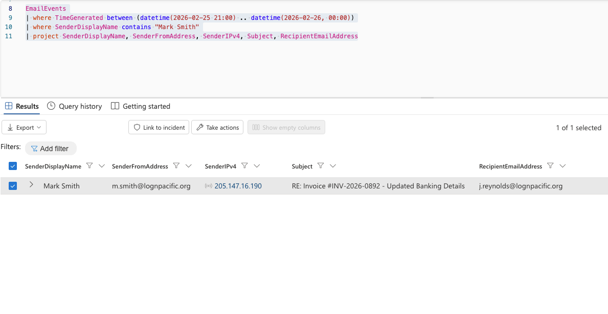

**Repeated MFA prompts.** Mark's sign-in logs showed many One Outlook Web sign-ins from 205.147.16.190 in the Netherlands, with a mix of results including ResultType 50074 ("strong authentication required").

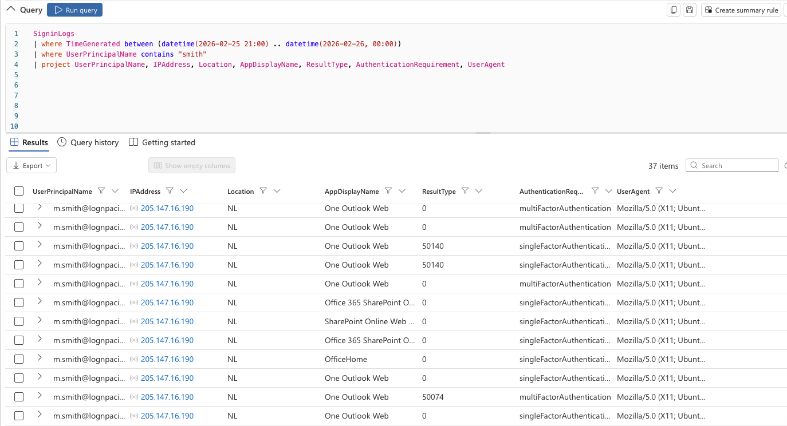

**Measuring the MFA fatigue.** Summarizing the attacker's One Outlook Web sign-ins by ResultType showed 24 successes (0), 4 results of 50140, and 2 results of 50074. Code 50140 is the "Keep me signed in?" interrupt, not an MFA push, so it was excluded. Only the **2** 50074 events are genuine MFA challenges that were not completed.

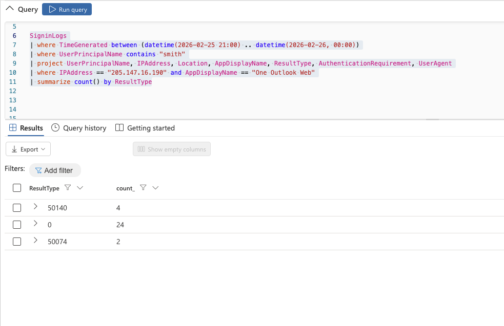

The two 50074 events occurred at 21:54:24 and 22:24:32 UTC, **30 minutes apart**. This is a slow, spaced-out pattern rather than a rapid-fire burst.

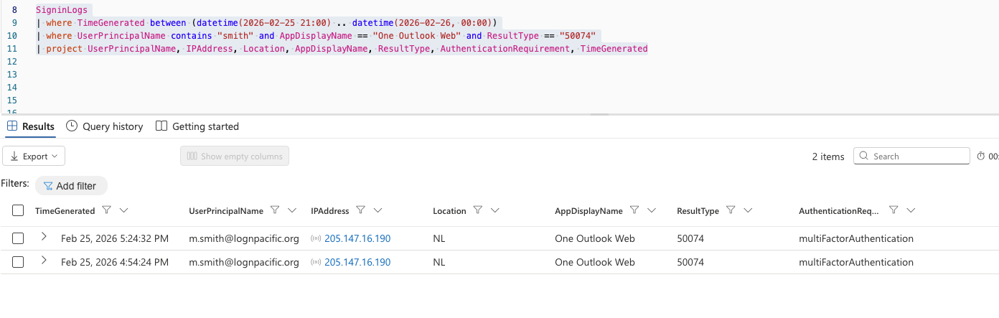

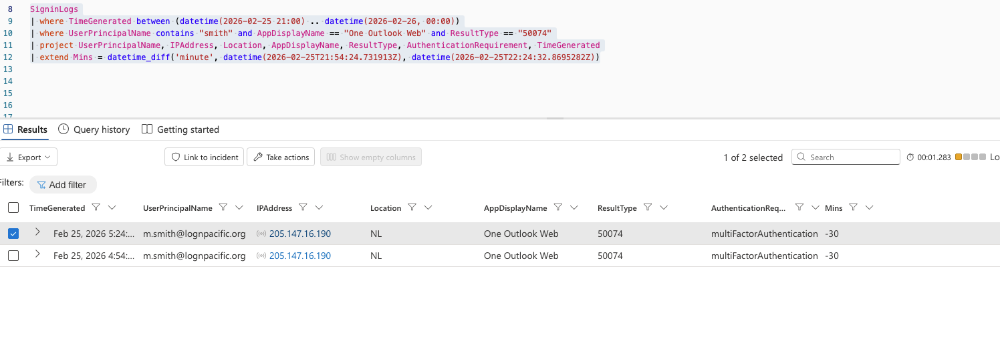

**Comparing device profiles.** Mark's legitimate sign-ins came from 172.175.65.103 (US) using Windows 10 with Chrome. The attacker's sign-ins came from 205.147.16.190 (NL) using Ubuntu Linux with Firefox 147.

```
Legitimate: Mozilla/5.0 (Windows NT 10.0; Win64; x64) AppleWebKit/537.36 (KHTML, like Gecko) Chrome/145...
Attacker:   Mozilla/5.0 (X11; Ubuntu; Linux x86_64; rv:147.0) Gecko/20100101 Firefox/147.0
```

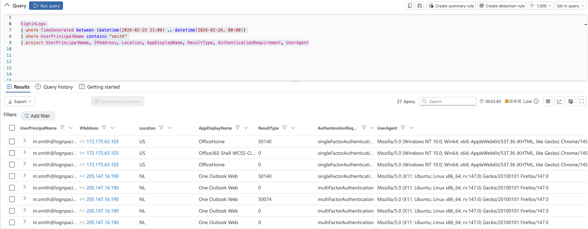

**Conditional Access gap.** All 30 attacker sign-ins to One Outlook Web show ConditionalAccessStatus = notApplied, meaning no policy evaluated or blocked them.

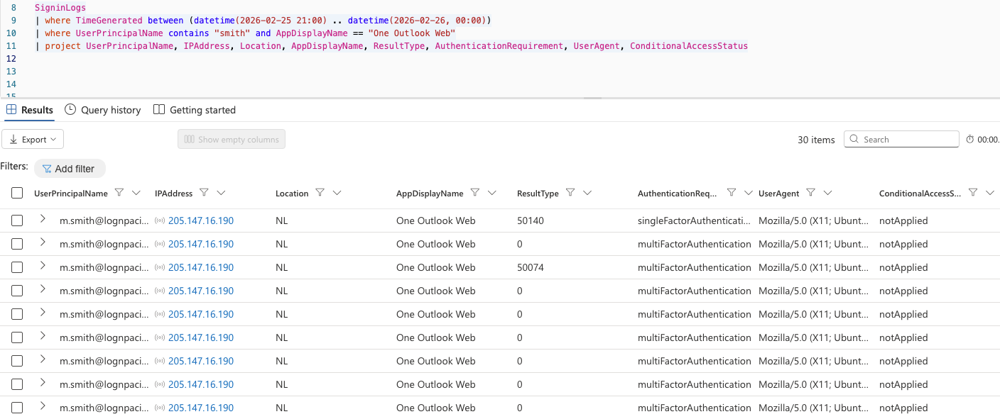

**Evidence boundary – the MFA bypass:**
- **Proves:** MFA was bypassed. Genuine MFA failures were followed by successful MFA-satisfied sign-ins from a foreign IP on a non-corporate device.
- **Does not prove:** How Mark's password was exposed in the first place.

### Pivoting & Correlation

**Post-authentication activity.** Pivoting on 205.147.16.190 in `CloudAppEvents` and sorting by time showed the attacker's actions in order. The first action was **MailItemsAccessed**, reading the mailbox before taking any other action. This was followed by two **New-InboxRule** events, another MailItemsAccessed, **Create**, and **Send**.

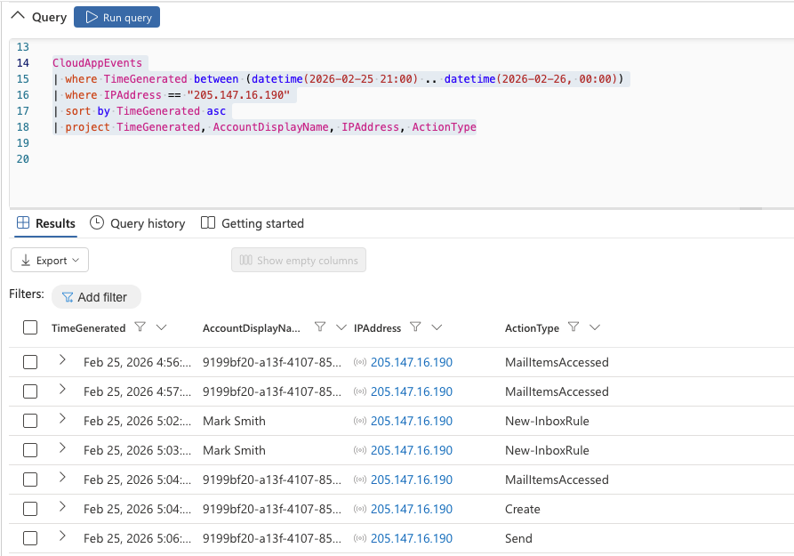

**Inbox rule 1 – Forwarding rule.** Reviewing the `RawEventData` for the first New-InboxRule event (22:02:33 UTC) showed:

| Parameter | Value |
|---|---|
| Name | `.` |
| ForwardTo | insights@duck.com |
| SubjectOrBodyContainsWords | invoice, payment, wire, transfer |
| StopProcessingRules | True |

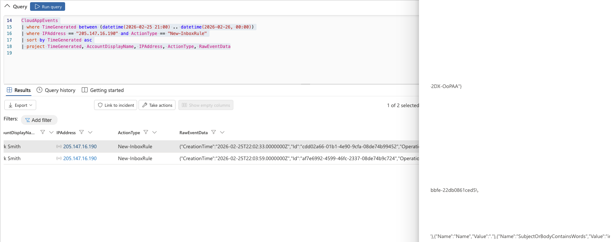

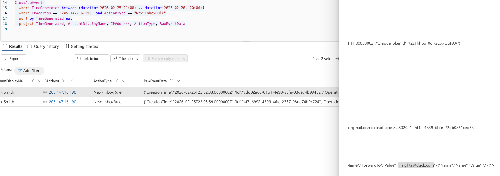

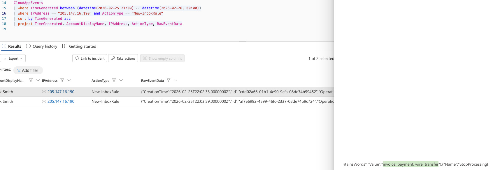

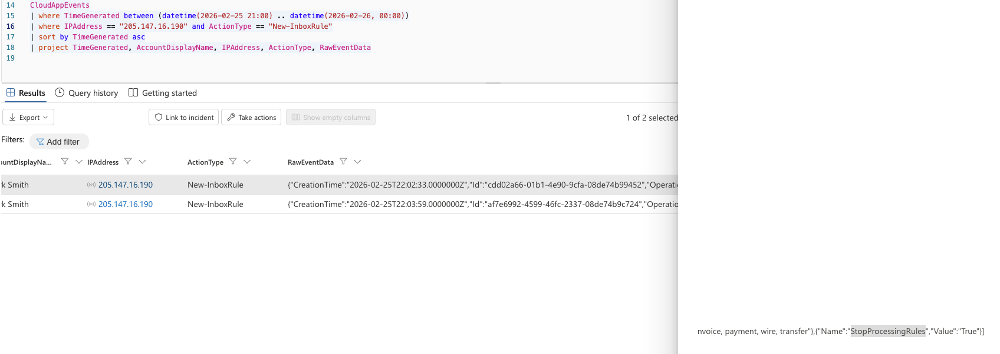

**Inbox rule 2 – Delete rule.** The second New-InboxRule event (22:03:59 UTC) showed:

| Parameter | Value |
|---|---|
| Name | `..` |
| SubjectOrBodyContainsWords | suspicious, security, phishing, unusual, compromised, verify |

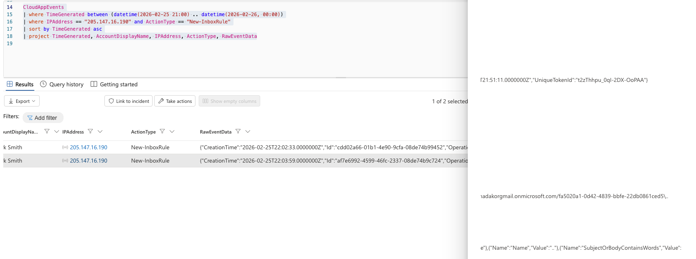

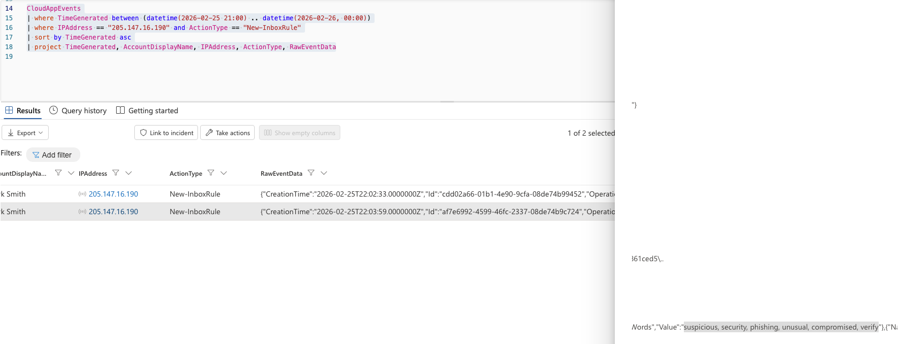

The two rules were created **86 seconds** apart, almost too fast for someone manually clicking through Outlook's rule wizard twice.

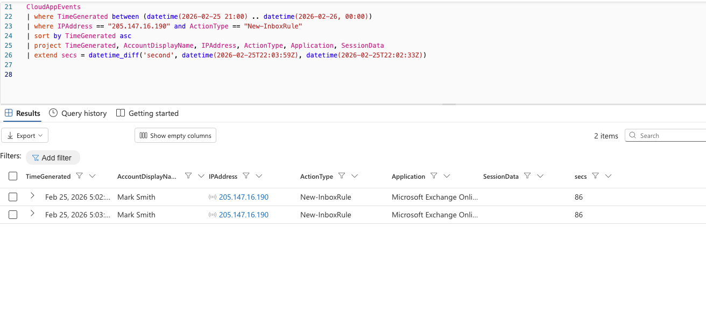

**The BEC email.** Pivoting to `EmailEvents` on the attacker IP identified the recipient, j.reynolds@lognpacific.org, and the full subject line. The "RE:" prefix shows the attacker replied inside an existing invoice thread (thread hijacking) rather than starting a new conversation.

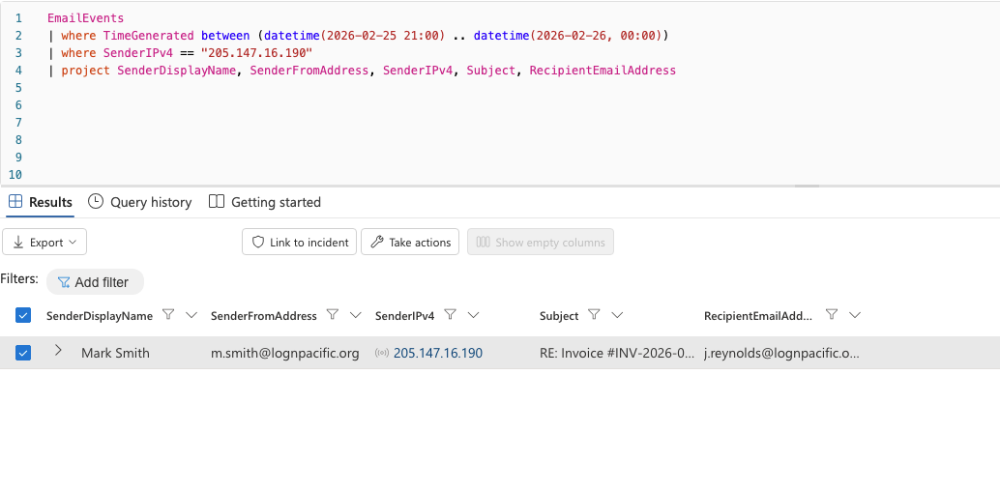

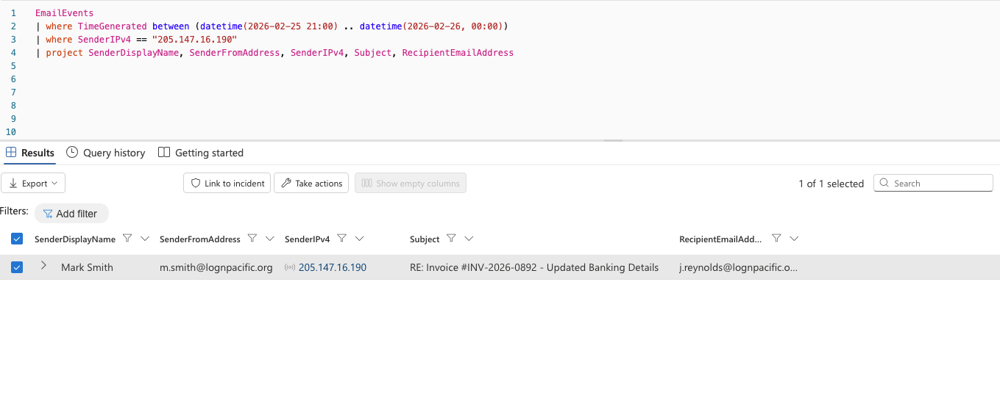

The email direction was **Intra-org**, so it never passed through external email gateway filtering.

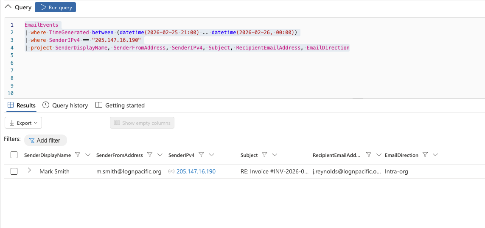

**Evidence boundary – the BEC email:**
- **Proves:** The attacker had control of Mark's mailbox and used it to send the fraudulent banking-detail change.
- **Does not prove:** That funds were transferred because of this email. That comes from the bank's report, not these logs.

**OneDrive access.** Filtering the attacker IP for FileAccessed events showed access to **Microsoft OneDrive for Business** at about 22:07 UTC.

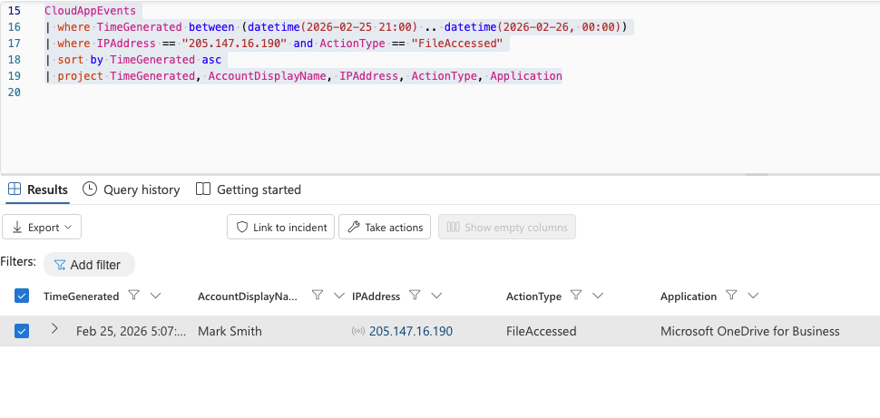

**Session correlation.** The attacker's sign-ins share session ID **00225cfa-a0ff-fb46-a079-5d152fcdf72a**, separate from Mark's legitimate session (00225cfa-da50-199a-5f16-eb6cfcffbc2f). This ID ties together the attacker's activity.

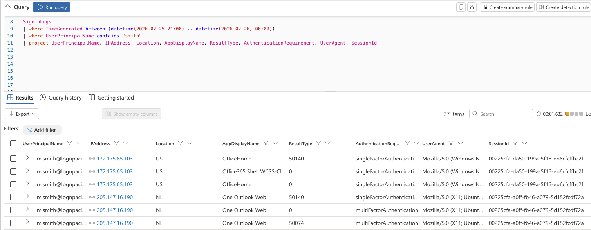

**Ruling out the baseline.** Mark's own activity from 172.175.65.103 was reviewed separately. It came from the US, on a Windows device, with no failed MFA challenges (50074). It does not match the attacker's pattern, and Mark's legitimate session is considered **not compromised**.

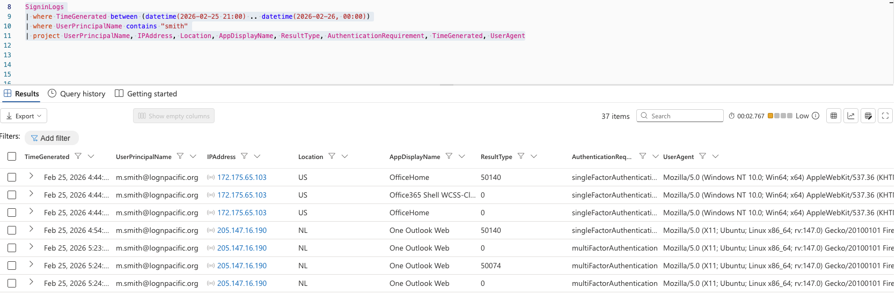

### Attack Timeline

| Timestamp (UTC) | Host / Source | Event | Source | ATT&CK |
|---|---|---|---|---|
| 2026-02-25 21:44 | 172.175.65.103 (US) | Mark's legitimate sign-ins to OfficeHome and Office365 Shell (Windows/Chrome) | SigninLogs | N/A – baseline |
| 2026-02-25 21:54 | 205.147.16.190 (NL) | First sign-in attempt to One Outlook Web from Ubuntu/Firefox (50140) | SigninLogs | T1078.004 |
| 2026-02-25 21:54:24 | 205.147.16.190 (NL) | Genuine MFA challenge not completed #1 (50074) | SigninLogs | T1621 |
| 2026-02-25 21:56 | 205.147.16.190 (NL) | MailItemsAccessed – first post-authentication action | CloudAppEvents | T1114 |
| 2026-02-25 21:57 | 205.147.16.190 (NL) | MailItemsAccessed | CloudAppEvents | T1114 |
| 2026-02-25 22:02:33 | 205.147.16.190 (NL) | New-InboxRule `.` – forward financial emails to insights@duck.com | CloudAppEvents | T1114.003 |
| 2026-02-25 22:03:59 | 205.147.16.190 (NL) | New-InboxRule `..` – hide security-related emails | CloudAppEvents | T1564.008 |
| 2026-02-25 22:04 | 205.147.16.190 (NL) | MailItemsAccessed, then Create | CloudAppEvents | T1114 |
| 2026-02-25 22:06 | 205.147.16.190 (NL) | Send – BEC email "RE: Invoice #INV-2026-0892 - Updated Banking Details" to j.reynolds | CloudAppEvents / EmailEvents | T1534 |
| 2026-02-25 22:07 | 205.147.16.190 (NL) | FileAccessed – Microsoft OneDrive for Business | CloudAppEvents | T1530 |
| 2026-02-25 22:23 | 205.147.16.190 (NL) | Successful MFA-satisfied sign-in to One Outlook Web | SigninLogs | T1078.004 |
| 2026-02-25 22:24:32 | 205.147.16.190 (NL) | Genuine MFA challenge not completed #2 (50074) | SigninLogs | T1621 |
| 2026-02-26 09:30 | External | Bank fraud department reports redirected £24,500 payment (funds frozen) | Incident report | N/A |

### How the Findings Link Together

The attacker already had Mark Smith's password. To get past MFA, they sent repeated push notifications to his phone, spaced about 30 minutes apart, until Mark approved one to make them stop. They signed in to Outlook on the web from a Netherlands IP (205.147.16.190) using an Ubuntu Linux machine. Conditional Access did not apply, so nothing blocked the unmanaged device or foreign location.

The attacker's first move was to read Mark's mailbox and find an active invoice conversation. Within about a minute and a half, they created two inbox rules with nearly invisible names (`.` and `..`). The first quietly forwards any financial email to an attacker-controlled address. The second hides security warnings from Mark. With visibility secured and evidence hidden, the attacker replied inside the existing invoice thread with "updated banking details," sent to finance colleague j.reynolds. Because the email came from a real coworker's mailbox inside the organization, it looked legitimate and bypassed external email filtering. The finance team processed the change, and £24,500 was redirected before the bank froze the funds. The attacker also accessed OneDrive for Business during the same session.

This combination of MFA fatigue for initial access, inbox rules used to hide evidence rather than deploy malware, and finance-focused BEC for profit matches the known playbook of **Scattered Spider**. This attribution is based on TTP overlap only, not on shared infrastructure, so it should be treated as medium confidence.

---

## 6. Indicators of Compromise

> IOCs in the tables are defanged ([.] and hxxp) so they are not clickable.

### Network IOCs

| Type | Value |
|---|---|
| IP Address (attacker) | 205.147.16[.]190 |
| Location | Netherlands (NL) |
| Email Address (forward destination) | insights@duck[.]com |
| User Agent | Mozilla/5.0 (X11; Ubuntu; Linux x86_64; rv:147.0) Gecko/20100101 Firefox/147.0 |
| Session ID | 00225cfa-a0ff-fb46-a079-5d152fcdf72a |

### Account and Email IOCs

| Type | Value |
|---|---|
| Compromised Account | m.smith@lognpacific.org |
| BEC Recipient | j.reynolds@lognpacific.org |
| BEC Subject | RE: Invoice #INV-2026-0892 - Updated Banking Details |
| Email Direction | Intra-org |
| Inbox Rule 1 Name | `.` |
| Inbox Rule 1 Keywords | invoice, payment, wire, transfer |
| Inbox Rule 2 Name | `..` |
| Inbox Rule 2 Keywords | suspicious, security, phishing, unusual, compromised, verify |

### File IOCs

| Type | Value |
|---|---|
| N/A | No malicious files were observed. This attack used valid credentials and native Microsoft 365 features only. |

### Behavioral IOCs

| Description |
|---|
| Repeated MFA challenges (ResultType 50074) followed by a successful sign-in from a new IP and device |
| Sign-in from an unfamiliar country and non-corporate OS (Ubuntu Linux) for a user who normally uses Windows |
| MailItemsAccessed as the first action after sign-in |
| Inbox rules with near-empty names (`.` and `..`) created 86 seconds apart |
| Inbox rule forwarding financial keywords to an external address with StopProcessingRules = True |
| Inbox rule targeting security-related keywords to hide alerts |
| Reply to an existing invoice thread with changed banking details, sent from the compromised account |

### Copy-Paste IOC List

```
205.147.16[.]190
insights@duck[.]com
00225cfa-a0ff-fb46-a079-5d152fcdf72a
Mozilla/5.0 (X11; Ubuntu; Linux x86_64; rv:147.0) Gecko/20100101 Firefox/147.0
RE: Invoice #INV-2026-0892 - Updated Banking Details
```

---

## 7. Intelligence Gaps

| Gap | Impact on Hunt | How to Close It |
|---|---|---|
| No evidence of how Mark's password was originally exposed | Cannot confirm the initial credential source (phishing, reuse, help desk social engineering, or a breach dump) | Review identity protection risk detections, help desk ticket history, and dark web/credential leak monitoring |
| Specific OneDrive file(s) accessed are not identified in the queried fields | Data exposure cannot be fully scoped | Query `ObjectName` / file path fields in `CloudAppEvents` or the unified audit log |
| Contents of mail items accessed are unknown | Cannot confirm which conversations or data the attacker read | Review MailItemsAccessed audit details (folders and InternetMessageIds) |
| Body of the BEC email and the attacker's bank account details are not in `EmailEvents` | Cannot share the fraudulent account details with the bank from these logs | Retrieve the message from j.reynolds's mailbox using content search |
| Details of the "Create" action are unknown | Unclear whether this was a draft, a new item, or another object | Review the `RawEventData` for the Create event |
| No MFA authenticator app or device logs | Cannot see the exact push notifications delivered to Mark's phone | Review Entra authentication method activity and authenticator logs |
| No visibility into whether insights@duck.com received forwarded emails | Cannot confirm how much financial email was exfiltrated | Review message trace for emails forwarded by the rule |

---

## 8. ATT&CK Mapping

| Tactic | Technique | Technique ID | Observed In |
|---|---|---|---|
| Resource Development | Compromise Accounts | T1586 | Attacker obtained and used Mark Smith's credentials |
| Initial Access / Persistence / Defense Evasion | Valid Accounts | T1078 | Attacker signed in with a legitimate user account |
| Initial Access / Persistence / Defense Evasion | Valid Accounts: Cloud Accounts | T1078.004 | Sign-ins to One Outlook Web from 205.147.16[.]190 |
| Credential Access | Multi-Factor Authentication Request Generation | T1621 | Repeated MFA pushes; 2 genuine MFA failures (50074) 30 minutes apart |
| Collection | Email Collection | T1114 | MailItemsAccessed as the first post-authentication action |
| Collection | Email Collection: Email Forwarding Rule | T1114.003 | Rule `.` forwarding financial emails to insights@duck[.]com |
| Defense Evasion | Hide Artifacts: Email Hiding Rules | T1564.008 | Rule `..` hiding security-related emails; StopProcessingRules on rule `.` |
| Lateral Movement | Internal Spearphishing | T1534 | Thread-hijacked BEC email to j.reynolds@lognpacific.org |
| Collection | Data from Cloud Storage | T1530 | FileAccessed in Microsoft OneDrive for Business |

---

## 9. Recommendations

### Immediate

- [ ] Revoke all active sessions and refresh tokens for m.smith@lognpacific.org (first containment action, since the attacker still has a valid session)
- [ ] Reset Mark Smith's password and require MFA re-registration
- [ ] Delete inbox rules `.` and `..` from Mark Smith's mailbox
- [ ] Block 205.147.16[.]190 and the forwarding address insights@duck[.]com
- [ ] Notify j.reynolds, the finance team, and leadership; recall or quarantine the BEC email
- [ ] Work with the bank to keep the £24,500 frozen and support recovery
- [ ] Preserve all logs and evidence for the IR case

### Short-Term

- [ ] Enable MFA number matching or phishing-resistant MFA (FIDO2 / Windows Hello) to stop MFA fatigue
- [ ] Create Conditional Access policies requiring compliant devices and restricting risky or unfamiliar locations
- [ ] Disable automatic forwarding to external domains at the tenant level
- [ ] Search all mailboxes for inbox rules with external forwarding or near-empty names
- [ ] Require out-of-band verification (call back a known phone number) for any banking-detail change
- [ ] Identify and review the OneDrive file(s) the attacker accessed

### Long-Term

- [ ] Conduct recurring hunts for MFA fatigue patterns and suspicious inbox rule creation
- [ ] Train employees to report, not approve, unexpected MFA prompts
- [ ] Train finance staff on BEC and thread-hijacking red flags
- [ ] Strengthen help desk identity verification procedures, a known Scattered Spider entry point
- [ ] Improve visibility into file names, mail items accessed, and authenticator activity

---

## 10. Appendix & References

### Supporting Material

- Raw logs or filtered exports: N/A
- Screenshots or forensic artifacts: [./images/](./images/)
- IOCs in CSV or JSON: N/A
- Links to external intelligence reports: See References below
- Scripts or queries used during the hunt: See [3. Methodology – Queries Used](#queries-used)

### Glossary

| Term | Definition |
|---|---|
| BEC | Business Email Compromise – using a compromised or spoofed email account to trick employees into sending money or data |
| MFA Fatigue | Also called push bombing; sending repeated MFA prompts until the user approves one out of frustration |
| Thread Hijacking | Replying inside an existing email conversation to make a fraudulent message look legitimate |
| Inbox Rule | A mailbox rule that automatically forwards, moves, or deletes emails that match conditions |
| ResultType 0 | Successful sign-in |
| ResultType 50074 | Strong authentication (MFA) was required but not completed |
| ResultType 50140 | "Keep me signed in?" interrupt – not an MFA challenge |
| Conditional Access | Microsoft Entra policies that allow or block sign-ins based on conditions such as device, location, and risk |
| IOC | Indicator of Compromise – an artifact suggesting malicious activity |
| TTP | Tactics, Techniques, and Procedures – how an adversary operates |
| KQL | Kusto Query Language, used to query Microsoft Sentinel |

### References and External Sources

1. MITRE ATT&CK – https://attack.mitre.org/
2. MITRE ATT&CK, Scattered Spider (G1015) – https://attack.mitre.org/groups/G1015/
3. MITRE ATT&CK, T1621 Multi-Factor Authentication Request Generation – https://attack.mitre.org/techniques/T1621/
4. MITRE ATT&CK, T1564.008 Hide Artifacts: Email Hiding Rules – https://attack.mitre.org/techniques/T1564/008/
5. CISA, Scattered Spider Advisory (AA23-320A) – https://www.cisa.gov/news-events/cybersecurity-advisories/aa23-320a
6. Microsoft, Microsoft Entra authentication and authorization error codes – https://learn.microsoft.com/en-us/entra/identity-platform/reference-error-codes

---

## 11. Sensitivity Label

**Public** – Community threat hunt conducted in a cyber range environment. All email addresses, IPs, and domains represent simulated infrastructure.

---

*Report structure adapted from The Threat Hunter's Report Template v1.0 by Hunt.io, aligned with MITRE ATT&CK and the SANS Threat Hunting Methodology.*
